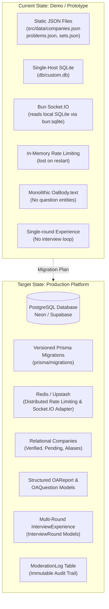

# Campus Placement Hub — Comprehensive Production Audit (Phase 0)

> **Date:** November 2026  
> **Repository:** `github.com/afrdbaig7/placement-vault`  
> **Auditor:** Senior Full-Stack Engineer  
> **Status:** Phase 0 Complete — Audit and Gap Analysis

---

## 1. Executive Summary

Campus Placement Hub (`placement-vault`) is currently architected as a prototype demonstration rather than a scalable production service. While recent hardening steps established foundational protections (OAuth PKCE/JWKS token parsing, HMAC-signed session cookies, CSRF tokens, basic in-memory rate limiting, and atomic Prisma `$transaction` blocks for coin accounting), the underlying persistence, data model, verification flows, and microservice infrastructure remain deeply coupled to static files, single-host SQLite databases, and unverified assumptions.

To reach the product goal of supporting verified student submissions for the **2026–27 hiring season (Class of 2027)**, user-added companies, structured multi-round interview experiences, and granular OA questions, substantial architectural refactoring is required.

---

## 2. Data Model Audit (`prisma/schema.prisma`)

The current schema comprises 10 SQLite models (`User`, `Drive`, `OaReport`, `OaBody`, `Unlock`, `CoinLedger`, `Experience`, `Doubt`, `Answer`, `Vote`, `Flag`).

### 2.1 Model-by-Model Breakdown

1. **`Company` (DOES NOT EXIST)**:
   - There is **no database model for companies**.
   - Company identity is represented solely as an unindexed plain `String` (slug) on `Drive.company`, `Experience.company`, and `Doubt.company`.
   - Valid company slugs are restricted by `src/lib/validation.ts` (`COMPANY_SLUGS`), which imports statically from `src/data/companies.json`.
   - **Impact:** Students cannot propose or add new companies. Moderation cannot approve or merge company records.

2. **`OaReport` & `OaBody`**:
   - `OaReport` fields: `id`, `authorId`, `driveId`, `round`, `platform`, `topics` (JSON string), `difficulty`, `outcome`, `summary`, `status` (PENDING | APPROVED | REJECTED | REMOVED), `modNote`, `upvoteCount`, `createdAt`.
   - `OaBody` fields: `id`, `reportId` (unique), `text` (single freeform string).
   - **Gaps against goal:**
     - Question text is stored as an unstructured monolithic string in `OaBody.text`. There is no `OAQuestion` entity.
     - No distinction between question types (`CODING`, `MCQ`, `SQL`, `APTITUDE`, `SUBJECTIVE`).
     - No fields for constraints, test cases, sample input/output, marks, or links to external/standard coding problems.
     - Missing temporal metadata: `hiringSeason` (e.g., "2026-27"), `graduatingBatch` (e.g., 2027), `assessmentDate`, `durationMin`, and structured `sections` (Aptitude, Coding, CS Fundamentals, etc.).
     - **Architectural Blocker:** `OaReport` has a strict mandatory foreign key to `Drive` (`driveId String`). Students cannot submit an OA report unless a moderator has already created a campus drive record for that exact company.

3. **`Experience`**:
   - Fields: `id`, `authorId`, `company` (string slug), `role`, `round`, `platform`, `topics` (JSON string), `difficulty`, `outcome`, `body`, `status`, `modNote`, `upvoteCount`, `createdAt`.
   - **Gaps against goal:**
     - Single freeform text `body` with a single `round` string (e.g., "Round 1").
     - There is no `InterviewRound` model. Students cannot document full interview loops (e.g., Technical 1 + Technical 2 Bar Raiser + HR) with round duration, interviewer notes, or round-specific questions.
     - Missing `hiringSeason`, `offerStatus` (Offered, Rejected, Waitlisted), `overallDifficulty`, `tips`.
     - No option for author anonymity.

4. **`Drive`**:
   - Fields: `id`, `company` (string slug), `role`, `driveDate`, `status` (`OPEN` | `CLOSED`), `branches` (CSV string), `minCgpa`, `notes`, `createdAt`.
   - Embargo operates on `Drive.status === "OPEN"`.
   - **Gaps against goal:**
     - Ties directly to hardcoded company slugs instead of a relational `Company` model.
     - `branches` stored as an unvalidated comma-separated string rather than structured tokens.

5. **`CoinLedger` & `Unlock`**:
   - `CoinLedger`: Append-only transaction table (`userId`, `amount`, `reason`, `refId`, `note`, `createdAt`). Enforces deduplication via `@@unique([userId, reason, refId])`.
   - `Unlock`: Junction table (`userId`, `reportId`, `free`, `createdAt`) with unique `[userId, reportId]`.
   - **Evaluation:** Clean, atomic, and solid. Works well inside Prisma `$transaction` blocks. Must be preserved and extended to handle 2026–27 fresh-contribution bounties.

6. **`User`**:
   - Fields: `id`, `email`, `name`, `image`, `role`, `rollNumber`, `rollVerified`, `placedCompany`, `batch`, `createdAt`.
   - **Gaps against goal:**
     - Any Google account (e.g., `@gmail.com`) can register.
     - No college domain enforcement, no institutional email verification, no OTP tracking.
     - No college/university model (platform assumes a single campus with no tenant separation).

7. **`Flag`**:
   - Fields: `id`, `reporterId`, `targetType` (`REPORT | EXPERIENCE | DOUBT | ANSWER`), `targetId`, `reason`, `resolved`, `createdAt`.
   - **Gaps against goal:**
     - Missing resolution audit metadata: `resolvedById`, `resolutionNote`, `actionTaken` (`DISMISSED | CONTENT_TAKEDOWN | USER_WARNED`).
     - No SLA indicators or priority levels.

8. **`ModerationLog` (DOES NOT EXIST)**:
   - State mutations (`status = "APPROVED"`, `resolved = true`, `rollVerified = true`) mutate records in-place.
   - There is no audit log recording who approved/rejected an item, the previous state, the new state, or the timestamp.

9. **`Problem` & `CompanyProblem` (DOES NOT EXIST)**:
   - Zero database presence. Coding problem catalogs are static JSON files.

---

## 3. Static Data Audit (`src/data/`)

The repository stores essential domain knowledge in static JSON files in `src/data/`:

| File | Size | Records | Usage in Code |
|---|---|---|---|
| `companies.json` | 21 KB | 16 companies | Hardcoded company registry. Imported in `src/lib/validation.ts` to build `COMPANY_SLUGS` whitelist; imported in `companies/route.ts`, `companies/[slug]/route.ts`, `contribute.tsx`, `drives.tsx`, `home.tsx`, `problems.tsx`. |
| `problems.json` | 78 KB | ~280 problem mappings across 16 companies | Hardcoded problem lists. Imported in `src/app/api/companies/route.ts`, `src/app/api/stats/route.ts`, and **directly bundled into client-side JS** in `src/components/views/problems.tsx`. |
| `sets.json` | 6.2 KB | 5 curated practice sets (Aptitude, Verbal, CS Core, etc.) | Bundled directly into client-side JS in `src/components/views/companies.tsx` and `src/components/views/problems.tsx`. |

### Architectural Flaws & Bottlenecks:
1. **Client Bundle Bloat:** `problems.json` (78 KB) and `sets.json` are bundled directly into the browser payload by Next.js, increasing initial JavaScript parse time.
2. **Immutability Barrier:** Any new company added by a student cannot be submitted or displayed because API validation schemas (`companySlugSchema`) fail on slugs not present in `companies.json`.
3. **Migration Requirement:** These files must become initial seed vectors (`prisma/seed.ts`), and all read paths must query a database table.

---

## 4. Git History & Secrets Exposure Audit

A forensic examination of all Git branches (`main`, `clean-main`, and historical commits) revealed:

```bash
git log --all --full-history --name-only -- ".env" "db/custom.db" "mini-services/chat-service/chat.db"
```

### 4.1 Historical Commits on `refs/heads/main`
In commits `3a2b305fa`, `eea8467ec`, and `5a969d6cd`:
1. **`.env` was committed to Git.**
   - Content: `DATABASE_URL=file:/home/z/my-project/db/custom.db`.
   - In earlier iterations, `src/lib/session.ts` used a fallback string: `"campus-placement-hub-local-secret"`.
2. **`db/custom.db` was committed to Git.**
   - A live SQLite database containing user IDs, test student profiles, and test coin balances was checked into repository history.
3. **`mini-services/chat-service/chat.db` was committed to Git.**
   - A live SQLite database containing chat messages and channel state was checked into repository history.

### 4.2 Current State on `clean-main`
- The `clean-main` branch excluded `.env`, `db/custom.db`, and `chat.db*`.
- `.gitignore` was updated with `db/*.db*`, `mini-services/chat-service/*.db*`, and `!.env.example`.

### 4.3 Mandatory Action Required: Secret Rotation Notice
> [!WARNING]
> While the committed `.env` file only contained a local SQLite path (`DATABASE_URL=file:/home/z/my-project/db/custom.db`), the historical repository history contains user IDs and internal database artifacts.
> 
> **Immediate Developer Action:**
> 1. If any **Google OAuth Client Secrets** (`GOOGLE_CLIENT_SECRET`) were ever generated or tested against this codebase, **revoke and regenerate them immediately** in the Google Cloud Console.
> 2. The `SESSION_SECRET` currently configured locally in `.env` (`793b35de39...`) must **never be reused in staging or production**. A brand new 256-bit cryptographically random secret must be provisioned in your production hosting environment.
> 3. Permanently scrub or drop the old sandbox branch (`refs/heads/main`) from the remote repository so the historical database blobs cannot be retrieved.

---

## 5. Chat Microservice Architecture Audit (`mini-services/chat-service/`)

The chat service is a standalone Bun service running Socket.IO on port `3004` (`mini-services/chat-service/index.ts`).

### 5.1 Main DB Coupling Flaw
In lines 66–80:
```typescript
function openMainDb(): Database | null {
  const candidates = [
    process.env.CHAT_MAIN_DB_PATH,
    path.resolve(__dirname, "../../db/custom.db"),
  ].filter((p): p is string => Boolean(p));

  for (const p of candidates) {
    if (fs.existsSync(p)) return new Database(p, { readonly: true });
  }
  return null;
}
const mainDb = openMainDb();
```
- The chat microservice imports `Database` from **`bun:sqlite`**.
- It opens the main Next.js database directly from the filesystem (`db/custom.db`) to look up user roles for fallback session cookies (`cph_session`).
- **Why this completely breaks in production:**
  1. **PostgreSQL Incompatibility:** `bun:sqlite` cannot connect to PostgreSQL. When the app moves to PostgreSQL, `openMainDb()` will fail completely.
  2. **Multi-Instance / Hosted Deployments:** If Next.js runs on Vercel/Fly.io and the chat service runs on Railway or a separate VPS, they do not share a local disk.
  3. **Split-Brain Storage:** The chat service stores its messages in a second SQLite database (`mini-services/chat-service/chat.db`), while user accounts live in `custom.db`.
  4. **No Horizontal Scaling:** Socket.IO is configured without a Redis adapter (`@socket.io/redis-adapter`). If two chat service instances run, users connected to instance A cannot see messages sent by users on instance B.

---

## 6. Rate Limiting Audit (`src/lib/rate-limit.ts`)

Rate limiting is implemented using an in-memory sliding/fixed-window bucket store:
```typescript
const MAX_BUCKETS = 10_000;
const buckets = new Map<string, BucketEntry>();
```

### Production Gaps:
1. **Process Volatility:** Any server restart, deployment, or auto-scaling event completely wipes all rate-limit counters.
2. **Serverless & Multi-Instance Failure:** On platforms like Vercel, AWS ECS, or Kubernetes, each server instance maintains its own isolated `buckets` Map. A client can bypass rate limits by distributing requests across instances.
3. **Memory Footprint:** While capped at 10,000 keys with a sweep function, in-memory Maps under DDoS can cause Node memory pressure.
4. **Resolution:** Must migrate to a distributed Redis backend (e.g., Upstash or Redis with sliding window scripts).

---

## 7. Roll-Number Verification & Email Domain Audit

### 7.1 Current Verification Workflow
1. User authenticates via Google OAuth. The platform accepts **any Google email address** (e.g., personal `@gmail.com`).
2. If `user.rollNumber` is null, `OnboardingDialog` blocks the UI and prompts for a roll number.
3. The client submits `POST /api/me` with `{ rollNumber }`.
4. `rollNumberSchema` checks only:
   ```typescript
   rollNumber: z.string().trim().regex(/^[A-Za-z0-9-]{4,20}$/, "Enter a valid roll number")
   ```
5. `user.rollNumber` is saved, and `user.rollVerified` remains `false`.
6. A moderator views `/api/mod/queue` and clicks "Verify".
7. `POST /api/mod/verify/[id]` marks `user.rollVerified = true` and awards 25 welcome coins.

### 7.2 Critical Vulnerabilities:
- **Zero Institutional Domain Check:** There is no check that the user's email matches an official college domain (e.g., `@nitt.edu`, `@iitb.ac.in`, `@bits-pilani.ac.in`).
- **Completely Spoofable Roll Numbers:** Any student can enter any valid alphanumeric string (e.g., `CS23B099`). There is no roster check, no university API verification, and no student ID proof upload.
- **Moderator Social Engineering / Rogue Mod Risk:** A moderator has no authoritative source inside the app to verify whether a submitted roll number genuinely belongs to the Google account holder.

---

## 8. Existing Tests Audit (`/tests`)

Inspection of the `tests/` directory revealed:
- `tests/database-runtime-build.sh`
- `tests/python-runtime-build.sh`
- `tests/python-runtime-container.sh`

### Audit Finding:
These files are **not platform tests**. They are legacy shell scripts from an upstream container build environment (`z.ai` Python runtime packing harness).
- **Unit Test Coverage:** 0%
- **Integration Test Coverage:** 0%
- **E2E Test Coverage:** 0%
- There are no test frameworks (Vitest, Jest, Playwright) configured in `package.json`.

---

## 9. Contradictions Between `README.md` and Actual Code

A line-by-line comparison between `README.md` and the codebase revealed significant discrepancies:

| Topic | README Claim | Actual Code Reality |
|---|---|---|
| **Database Workflow** | Recommends `bun run db:push` for database setup. | `package.json` defines `"db:push": "prisma db push --accept-data-loss"`. This drops data on schema mismatches and has zero migration history. |
| **Local Dev Command** | Recommends `bun run dev`. | `package.json` script is `"next dev -p 3000 2>&1 \| tee dev.log"`. On Windows PowerShell, `tee` is not an OS builtin and causes the command to fail. |
| **Company Directory** | Claims a "Company-wise directory with interview experiences, OA reports...". | Companies are not in the database. Only 16 static JSON entries exist. Students cannot add companies. |
| **OA Questions** | Implies structured OA questions. | There is no question model. Only a single unstructured text blob in `OaBody.text`. |
| **Chat Service Architecture** | Claims "Dedicated Bun + Socket.IO microservice with SQLite persistence...". | Masks the fatal flaw that the chat service reads directly from `../../db/custom.db` using `bun:sqlite`, preventing containerized or multi-host deployment. |
| **Test Suites** | Documents verification commands (`tsc`, `lint`, `next build`). | No test runner is documented because zero application tests exist. |

---

## 10. Summary of Architectural Gaps



---

## 11. Assumptions for Subsequent Phases

Before executing Phase 1 (Database and Data Model), the following operational assumptions are established:

1. **Database Strategy:**
   - Production will target PostgreSQL 16+.
   - Local development will use Docker Compose (`postgres:16-alpine`) so development mirrors production exactly.
   - Prisma will use versioned migrations (`prisma migrate dev` / `prisma migrate deploy`), completely replacing `prisma db push --accept-data-loss`.
2. **Backward Compatibility & Seeding:**
   - Existing data in `src/data/companies.json`, `problems.json`, and `sets.json` will be preserved as the initial database seed in `prisma/seed.ts`.
   - Seed scripts will be strictly idempotent.
3. **Data Model Extensions:**
   - `Company` will be introduced with normalized name uniqueness, aliases, and `status` (`VERIFIED | PENDING | REJECTED`).
   - `OaReport` will support submissions both tied to campus `Drive` records and standalone off-campus/historical assessments.
   - `OAQuestion` and `InterviewRound` will be first-class relational entities.
   - Embargo rules will strictly protect `OAQuestion` text while a drive remains `OPEN`.
4. **Chat Microservice Decoupling:**
   - The chat microservice will cease querying SQLite files on disk. Handshake authentication will rely exclusively on cryptographically signed HMAC WebSocket tokens issued by the Next.js API (`/api/chat/token`).
5. **No AI-Generated Fabrications:**
   - All company problems, questions, and interview records will come strictly from authentic imports or verified student submissions. Missing data will render helpful empty states encouraging contributions.

